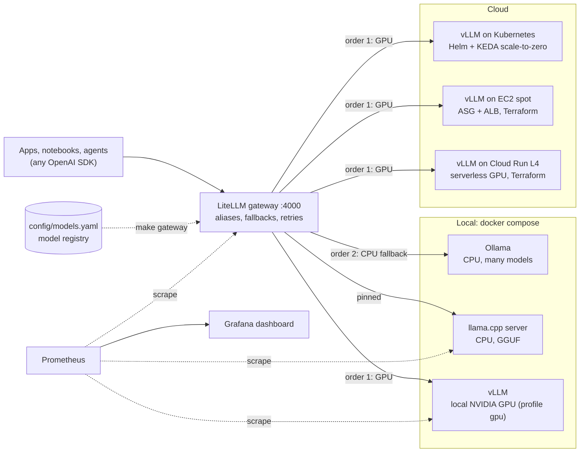
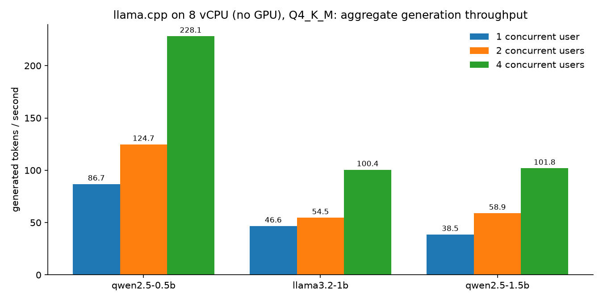
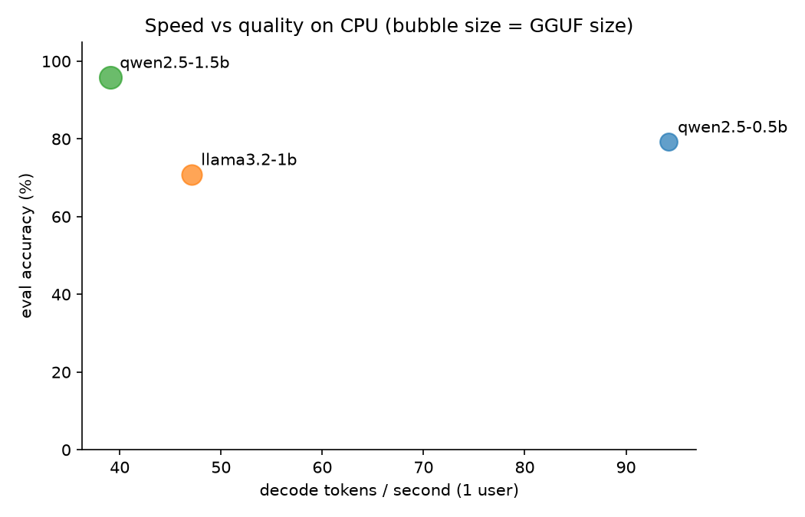

# open-llm-infra

[](https://github.com/sdiazricagno/open-llm-infra/actions/workflows/ci.yml)

Run many cheap open-source LLMs on a laptop, a single GPU box or the cloud, behind one OpenAI-compatible endpoint.

The same model registry drives every layer: Ollama and llama.cpp on CPU, vLLM on GPU, a LiteLLM gateway with
GPU-first routing and CPU fallback, Prometheus and Grafana for metrics, Terraform for AWS and Google Cloud, and a Helm
chart with scale-to-zero autoscaling. A benchmark CLI measures latency, throughput and answer quality against any
OpenAI-compatible endpoint, and every number below was measured, not copied.

## The problem

Small open-weight models (0.5B to 8B parameters) are now good enough for classification, extraction, routing,
summaries and agent tool calls, and they cost a fraction of a hosted frontier model. Using them in practice raises
the same questions every time:

- Which model, which quantisation and which serving engine for this hardware?
- How do apps call local and cloud models without code changes when a backend moves?
- What happens when the GPU node is cold, gone or out of capacity?
- What does a million tokens actually cost on CPU versus a spot GPU versus serverless GPU?

This repo answers them with one registry file, one gateway config and one benchmark harness.

## Architecture



Every model name in the gateway is a model group with two deployments: vLLM on GPU (order 1) and Ollama on CPU
(order 2). If the GPU backend is missing, cold or failing, LiteLLM cools it down and serves the request from CPU.
Backend URLs are environment variables (`OLLAMA_API_BASE`, `LLAMACPP_API_BASE`, `VLLM_<MODEL>_API_BASE`), so the
identical `gateway/litellm.yaml` runs in compose, in the Helm chart and in front of Terraform-built endpoints.

| Route | Example | Behaviour |
|---|---|---|
| `<model>` | `qwen2.5-1.5b` | GPU first, CPU fallback |
| `<model>@gpu` / `<model>@cpu` | `qwen2.5-7b@cpu` | Pin a backend |
| Alias | `fast`, `balanced`, `quality` | Primary model plus ordered fallbacks to other models |
| `llamacpp` | `llamacpp` | Whatever GGUF the llama.cpp container is serving |

## Quickstart

```bash
git clone https://github.com/sdiazricagno/open-llm-infra && cd open-llm-infra
make up      # Ollama + llama.cpp + gateway + Prometheus + Grafana, waits for healthchecks
make pull && make smoke   # pull qwen2.5:0.5b, llama3.2:1b, qwen2.5:1.5b and send one request to the gateway
```

Then point any OpenAI client at `http://localhost:4000/v1`:

```python
from openai import OpenAI

client = OpenAI(base_url="http://localhost:4000/v1", api_key="local")
reply = client.chat.completions.create(model="fast", messages=[{"role": "user", "content": "Hi"}])
print(reply.choices[0].message.content)
```

Grafana is on `http://localhost:3000` (anonymous viewer, dashboard "Open LLM infra"), Prometheus on `:9090`.
With an NVIDIA GPU and the container toolkit, `make up-gpu` adds vLLM and the same model names start routing to it.

## Local vs cloud

| | Local CPU | Local GPU | Kubernetes | AWS EC2 | Google Cloud Run |
|---|---|---|---|---|---|
| Engine | Ollama, llama.cpp | vLLM | vLLM | vLLM | vLLM |
| Where | `deploy/compose` | `deploy/compose --profile gpu` | `deploy/helm/open-llm` | `deploy/terraform/modules/aws-gpu-vllm` | `deploy/terraform/modules/gcp-cloudrun-vllm` |
| Scaling | fixed | fixed | KEDA on queued + running requests (to zero) or HPA via prometheus-adapter | ASG target tracking on ALB requests per target, spot optional | Cloud Run concurrency, min 0 instances |
| Idle cost | your machine | your machine | node pool cost | 0 with `desired_capacity = 0` | 0 at min instances 0 |
| Best for | dev, tests, tiny models | single-box serving | shared platform | steady traffic on spot | spiky traffic |

Cloud setup never needs credentials in the repo: Hugging Face tokens for gated models come from an existing
Kubernetes Secret, an SSM SecureString or Secret Manager, and the gateway master key comes from a Secret.
Nothing here has been applied to a real account. `make check` runs `terraform validate`, `helm lint` and
`docker compose config` alongside the Python checks.

```bash
cd deploy/terraform/envs/aws && cp terraform.tfvars.example terraform.tfvars   # fill in VPC and subnets
terraform init && terraform plan
# set the output VLLM_QWEN2_5_1_5B_API_BASE on the gateway; the model name qwen2.5-1.5b now prefers that GPU
```

## Model matrix

Rendered by `python -m openllm models` from `config/models.yaml`. GGUF sizes are the real Q4_K_M file sizes on
Hugging Face; the GPU fit column uses a rough VRAM guide per model, so treat it as a starting point.

| Model | Params (B) | License | Context | GGUF Q4_K_M GB | Ollama tag | vLLM repo | Fits (GPU) |
|---|---:|---|---:|---:|---|---|---|
| qwen2.5-0.5b | 0.5 | Apache-2.0 | 32768 | 0.49 | `qwen2.5:0.5b` | `Qwen/Qwen2.5-0.5B-Instruct` | g4dn.xlarge, g6.xlarge, g5.xlarge, g6e.xlarge, cloudrun-l4 |
| qwen2.5-1.5b | 1.5 | Apache-2.0 | 32768 | 1.12 | `qwen2.5:1.5b` | `Qwen/Qwen2.5-1.5B-Instruct` | g4dn.xlarge, g6.xlarge, g5.xlarge, g6e.xlarge, cloudrun-l4 |
| qwen2.5-7b | 7.6 | Apache-2.0 | 32768 | 4.68 | `qwen2.5:7b` | `Qwen/Qwen2.5-7B-Instruct-AWQ` | g4dn.xlarge, g6.xlarge, g5.xlarge, g6e.xlarge, cloudrun-l4 |
| llama3.2-1b | 1.2 | Llama 3.2 Community | 131072 | 0.81 | `llama3.2:1b` | `meta-llama/Llama-3.2-1B-Instruct (gated)` | g4dn.xlarge, g6.xlarge, g5.xlarge, g6e.xlarge, cloudrun-l4 |
| llama3.2-3b | 3.2 | Llama 3.2 Community | 131072 | 2.02 | `llama3.2:3b` | `meta-llama/Llama-3.2-3B-Instruct (gated)` | g4dn.xlarge, g6.xlarge, g5.xlarge, g6e.xlarge, cloudrun-l4 |
| phi3.5-mini | 3.8 | MIT | 131072 | 2.39 | `phi3.5:3.8b` | `microsoft/Phi-3.5-mini-instruct` | g4dn.xlarge, g6.xlarge, g5.xlarge, g6e.xlarge, cloudrun-l4 |
| gemma2-2b | 2.6 | Gemma | 8192 | 1.71 | `gemma2:2b` | `google/gemma-2-2b-it (gated)` | g4dn.xlarge, g6.xlarge, g5.xlarge, g6e.xlarge, cloudrun-l4 |
| mistral-7b | 7.2 | Apache-2.0 | 32768 | 4.37 | `mistral:7b` | `mistralai/Mistral-7B-Instruct-v0.3 (gated)` | g6.xlarge, g5.xlarge, g6e.xlarge, cloudrun-l4 |

## Benchmark results (measured)

Measured on 25 Nov 2026 on an 8 vCPU Intel Xeon VM with no GPU (15 GiB RAM), llama.cpp build b12734,
Q4_K_M GGUFs, `-t 8 --parallel 4 -c 8192`. Each concurrency level sends 8 streamed requests with up to 128
generated tokens; quality is the 24-item `config/evalset.yaml` with greedy decoding. Raw JSON for every run,
including load averages at start and end, is in `results/`. Other processes on the machine stayed below 15% of
one core during the run. Small samples on a shared VM: treat the numbers as indicative, within roughly 10-20%.

| Model (Q4_K_M) | GGUF GB | Load s | TTFT p50 s | Decode tok/s (1 user) | p50 latency s | Peak tok/s (users) | Quality | Est. $/1M tok on c7i.2xlarge |
|---|---:|---:|---:|---:|---:|---:|---:|---:|
| qwen2.5-0.5b | 0.49 | 1.4 | 0.08 | 94.2 | 1.4 | 228.1 (4) | 19/24 | 0.43 |
| llama3.2-1b | 0.81 | 1.1 | 0.03 | 47.1 | 2.6 | 100.4 (4) | 17/24 | 0.99 |
| qwen2.5-1.5b | 1.12 | 2.1 | 0.04 | 39.1 | 3.2 | 101.8 (4) | 23/24 | 0.97 |





What the numbers say:

- **Qwen2.5 1.5B is the sweet spot on CPU**: 23/24 on the quality check at 39 tokens/s for one user, and
  about 102 tokens/s in total with four users, with a time to first token around 40 ms.
- **Qwen2.5 0.5B is the speed tier**: 94 tokens/s for one user and 228 tokens/s with four users, enough for routing,
  tagging and extraction at an estimated $0.43 per million generated tokens on an always-on c7i.2xlarge. It missed
  5 of 24 items, mostly multi-step arithmetic.
- **Llama 3.2 1B was the weakest here** (17/24, missing unit conversions and simple logic) while being slower than
  Qwen 0.5B, so the `fast` alias points at Qwen first and keeps Llama as a fallback.
- **Batching is free throughput on CPU**: four concurrent users gave 2.2x to 2.6x the single-user throughput,
  while each user's own decode speed dropped to about 28 to 63 tokens/s.
- **The gateway adds very little**: the same Qwen 0.5B server measured directly and through the LiteLLM gateway
  (`results/gateway-overhead/`) gave a p50 time to first token of 30 ms vs 37 ms and a p50 request latency of
  1.12 s vs 1.20 s for one user. With four users, aggregate throughput was 189 vs 207 tokens/s, which is inside
  run-to-run noise.
- **GPU fallback works**: with the vLLM backend for `qwen2.5-0.5b` pointed at a dead address, requests to
  `qwen2.5-0.5b` were still answered by the CPU deployment, and the gateway marked the GPU deployment as cooled
  down in its Prometheus metrics (`litellm_deployment_state`).

The registry lists eight models; only the three above were benchmarked. Larger ones (Gemma 2 2B, Llama 3.2 3B,
Phi-3.5 mini, 7B models) run through the same script.

Reproduce on your own machine (downloads the GGUFs into `./models` if missing):

```bash
pip install -r requirements-dev.txt
LLAMA_SERVER=/path/to/llama-server scripts/bench_cpu.sh qwen2.5-0.5b llama3.2-1b qwen2.5-1.5b
python -m openllm report     # rewrites docs/benchmark_table.md and the charts
```

`python -m openllm bench` works against any OpenAI-compatible URL, so the same command benchmarks the gateway, a
vLLM pod or a Cloud Run endpoint.

## Cost notes

List prices below are **estimates** copied from the public pricing pages on the date shown (us-east-1 or
us-central1, Linux, on-demand, excluding storage and egress). Check them before budgeting; spot prices move hourly.

Estimated list prices, checked 2026-11-25. Verify before budgeting.

| Option | Accelerator | VRAM GB | $/hour | $/month 24x7 | Billing | Source |
|---|---|---:|---:|---:|---|---|
| aws-c7i.2xlarge | none (8 vCPU, 16 GiB) | 0 | 0.3570 | 257 | per-second, always on | [link](https://aws.amazon.com/ec2/pricing/on-demand/) |
| aws-g4dn.xlarge | 1x NVIDIA T4 | 16 | 0.5260 | 379 | per-second, always on (spot cheaper, interruptible) | [link](https://aws.amazon.com/ec2/pricing/on-demand/) |
| aws-g6.xlarge | 1x NVIDIA L4 | 24 | 0.8048 | 579 | per-second, always on (spot cheaper, interruptible) | [link](https://aws.amazon.com/ec2/pricing/on-demand/) |
| aws-g5.xlarge | 1x NVIDIA A10G | 24 | 1.0060 | 724 | per-second, always on | [link](https://aws.amazon.com/ec2/pricing/on-demand/) |
| aws-g6e.xlarge | 1x NVIDIA L40S | 48 | 1.8610 | 1,340 | per-second, always on | [link](https://aws.amazon.com/ec2/pricing/on-demand/) |
| gcp-cloudrun-l4 | 1x NVIDIA L4, 4 vCPU, 16 GiB, no zonal redundancy | 24 | 1.0465 | 753 | per-second while an instance exists, scales to zero | [link](https://cloud.google.com/run/pricing) |

How to read it:

- `$ / 1M tokens = $ per hour / (tokens per second x 3600) x 1,000,000`, at full utilisation. Idle time raises the
  real figure, which is why scale-to-zero matters more than the hourly rate for spiky traffic.
- The CPU column in the benchmark table applies this formula to the throughput measured above, priced as a
  c7i.2xlarge (8 vCPU, the same core count as the benchmark machine). It is an estimate, not a bill.
- For GPUs, run `python -m openllm bench` against your endpoint and feed the measured throughput into
  `python -m openllm costs --tps <tokens per second>`. No GPU throughput is quoted here because none was measured.

## Repo layout

```
config/models.yaml        model registry (single source of truth)
config/evalset.yaml       24-item quality smoke test
config/costs.yaml         priced instances with sources and check date
gateway/litellm.yaml      rendered gateway config (`make check` fails if stale)
deploy/compose/           docker compose stack, Prometheus and Grafana provisioning
deploy/helm/open-llm/     vLLM + gateway chart with KEDA or HPA autoscaling
deploy/terraform/         aws-gpu-vllm and gcp-cloudrun-vllm modules, example envs
src/openllm/              registry, gateway renderer, benchmark client, cost maths, report
scripts/bench_cpu.sh      llama.cpp CPU benchmark runner
results/                  raw benchmark JSON
docs/                     charts and the generated benchmark table
```

## Development

```bash
make install
make check   # ruff, pytest, gateway freshness, terraform fmt/validate, helm lint, compose config
```

## License

MIT
